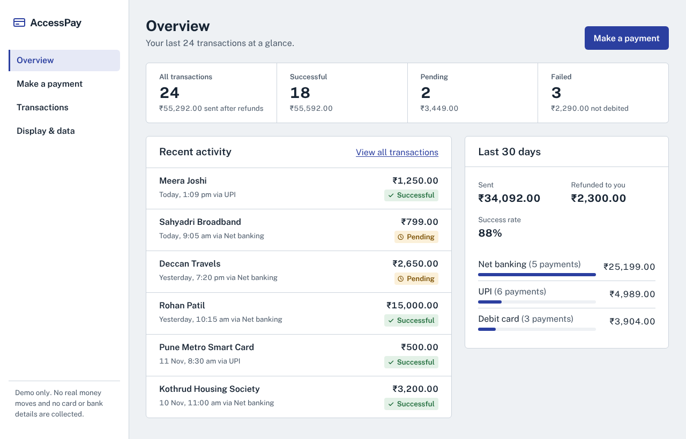
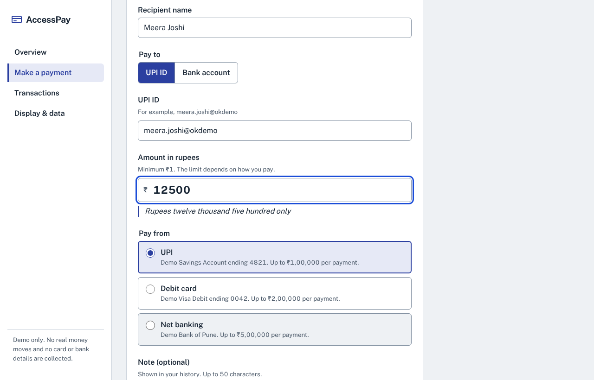
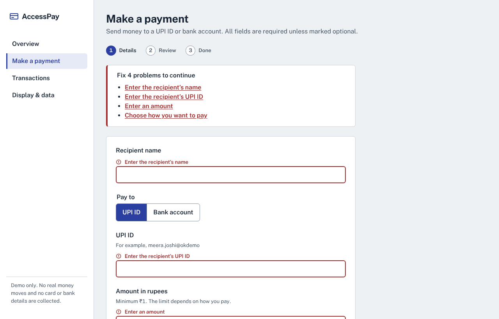
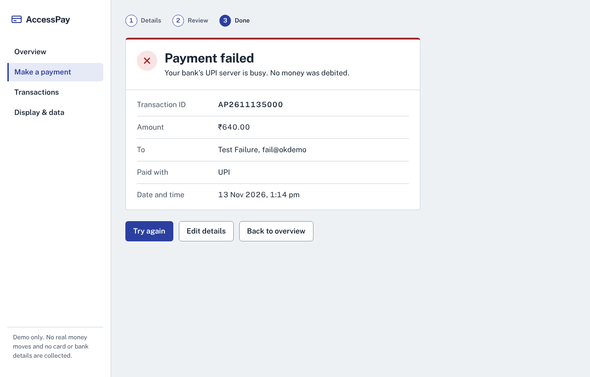
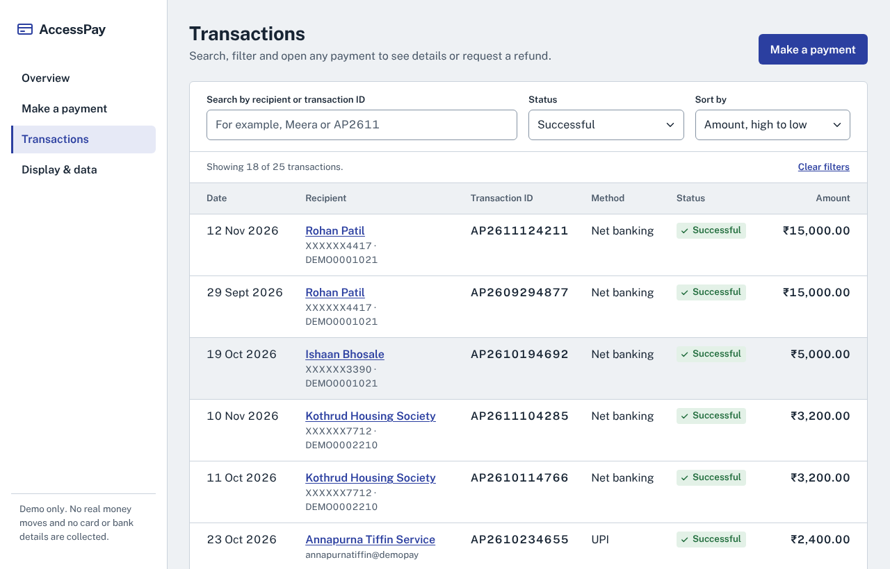
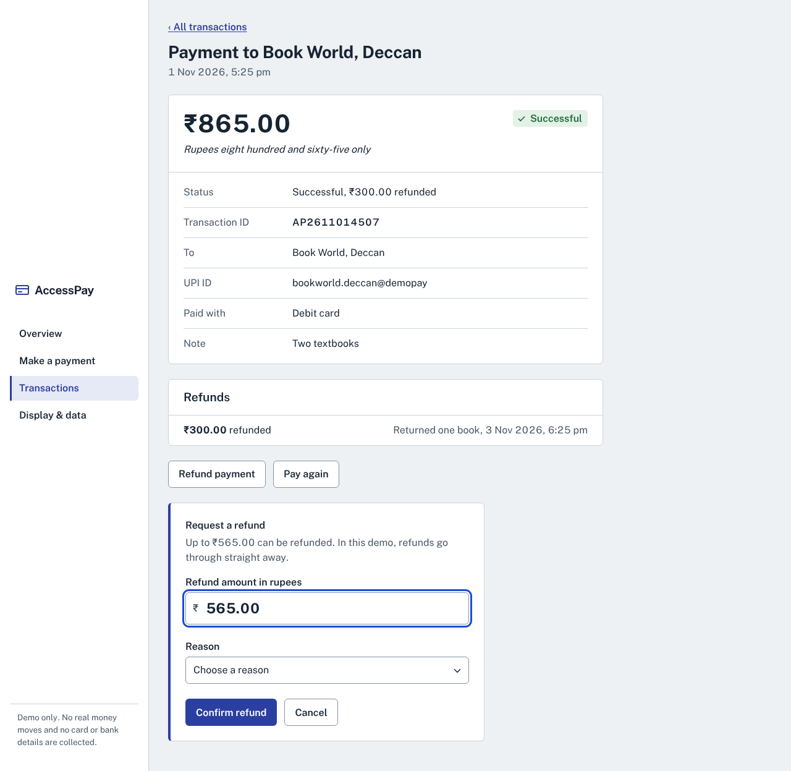
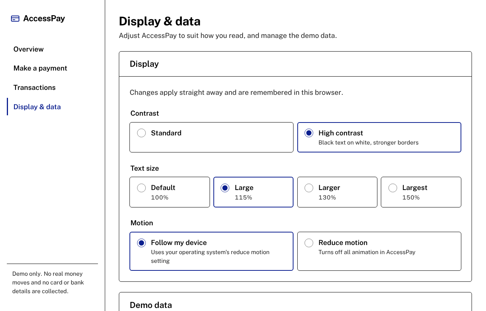
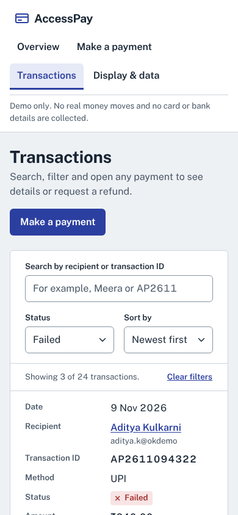

# AccessPay

An accessible digital payment demo built with plain HTML, CSS and JavaScript.
You can make payments, track their status, search your history and request
refunds. Accessibility is part of every screen, not a separate mode.

> **Everything is simulated.** AccessPay never asks for card numbers, UPI PINs
> or bank passwords, and no money moves. Data stays in your browser's
> `localStorage`.



## Features

**Overview**
- Counts and totals for all, successful, pending and failed payments. Each one links to a filtered list.
- The six most recent payments.
- A 30-day summary: money sent, refunds received, success rate and a breakdown by payment method.
- An empty state with a clear next step once history is cleared.

**Payment checkout**
- Pay a UPI ID or a bank account (account number entered twice, plus IFSC).
- Choose one of three demo payment methods: UPI, debit card or net banking. Each has its own per-payment limit.
- Validation with an error summary at the top that receives focus. Each message sits next to its field and is linked to it, and errors clear as you fix them.
- **Amount in words, cheque style** ("Rupees twelve lakh fifty thousand only"). It makes an extra or missing zero obvious before you pay.
- A review step, then a success, failure or pending result. The pay button can't be pressed twice.

**Transactions**
- Search by recipient name, transaction ID or UPI ID.
- Filter by status. Sort by date or amount.
- Filters are kept in the URL, so reloads, bookmarks and the back button keep them.
- Each transaction has a details page with full information and its refund history.
- Full or partial refunds within 30 days of a successful payment.
- Pending payments can be re-checked.
- "Pay again" pre-fills checkout for UPI payments.

**Display & data**
- High contrast mode, four text sizes (100% to 150%) and a reduce motion option.
- These apply instantly and are remembered.
- Delete all transactions (with a confirmation step) or restore the sample data.

## Technology

| Part | Choice | Why |
|---|---|---|
| Markup | HTML5 | Semantic elements do most of the accessibility work |
| Styling | CSS3 with custom properties | Themes (high contrast, text size) are just variable overrides |
| Logic | Vanilla JavaScript (ES modules) | No build step; each file is small enough to read top to bottom |
| Storage | `localStorage` | Enough for a single-user demo; wrapped in one module |
| Font | Public Sans, self-hosted | A clear open font (SIL OFL) designed for accessible government services |
| Unit tests | Node's built-in `node:test` | No test framework to install |
| Browser tests | Playwright + axe-core | Real keyboard and screen-reader-facing checks; dev dependencies only |

There is no REST API. A payment app's API would be a bank or payment
gateway, and pretending to call one would add code without adding anything
real. The gateway is simulated in `js/lib/payment.js` instead.

## Running it

ES modules don't load from `file://`, so the files need to be served over HTTP.

```bash
git clone https://github.com/Nabha756/AccessPay.git
cd AccessPay
npm start            # runs: python3 -m http.server 4173
```

Then open <http://localhost:4173>. Any static server works, for example the
VS Code Live Server extension or `npx serve`.

### Demo tips

Payments usually succeed. To see the other outcomes on purpose:

| Pay to | Result |
|---|---|
| `fail@okdemo` | Always fails |
| `pending@okdemo` | Stays pending, even after "Check payment status" |
| Any bank account ending in `0000` | Always fails |

Other payments have a small random chance of failing or staying pending, as a real gateway might.

## Folder structure

```
AccessPay/
├── index.html              Page shell: skip link, navigation, <main>, live regions
├── css/
│   ├── base.css            Design tokens, font, reset, focus ring, contrast/motion modes
│   ├── layout.css          Sidebar + content layout and the mobile layout
│   └── components.css      Buttons, panels, forms, tables, badges, page-specific parts
├── js/
│   ├── app.js              Hash router: picks the view and manages focus on navigation
│   ├── store.js            Reads and writes transactions in localStorage
│   ├── data/seed.js        Sample transactions (dates relative to today)
│   ├── lib/                Pure logic with no DOM access (unit tested)
│   │   ├── validation.js   Checkout field rules and amount parsing
│   │   ├── amount-words.js Amount in words (Indian numbering)
│   │   ├── payment.js      Simulated gateway, IDs, pending status checks
│   │   ├── transactions.js Stats, search, filter, sort, refunds
│   │   ├── settings.js     Display preferences
│   │   ├── format.js       Currency, dates, labels
│   │   └── dom.js          HTML escaping, announcements, focus, icons
│   └── views/              One file per page; builds markup and wires events
├── assets/                 Font files and favicon
├── tests/
│   ├── unit/               node:test, logic only
│   └── e2e/                Playwright, runs the real app in Chrome
└── docs/screenshots/
```

## Design decisions

- **Money is stored in paise (integers).** `0.1 + 0.2` isn't `0.3` in
  JavaScript, so rupee decimals slowly drift when added up. Amounts are
  parsed from the typed digits straight into paise and only converted for
  display.
- **Only the last four digits of an account number are saved**, as on a bank
  statement. That's also why "Pay again" only works for UPI payments.
- **Logic and views are kept apart.** Everything in `js/lib/` is a pure
  function, so it can be tested in Node without a browser. The views only
  turn data into markup and handle events.
- **Views use template strings.** Every value from the user or from storage
  goes through `escapeHtml()`. A browser test checks that a recipient named
  `` shows as text.
- **Each page render gets a fresh root element**, so event listeners from the
  previous page are thrown away with it.
- **Hash routing** (`#/transactions/AP2611131234`) because the app is static
  files. Every screen still has its own address.

## Accessibility

Target: **WCAG 2.2 level AA**.

- Semantic structure: landmarks, one `h1` per page, real `<table>`, `<fieldset>`/`<legend>` for radio groups, labels on every input.
- A skip link. On navigation, focus moves to the new page's heading, which screen readers read out.
- A visible 3px focus ring on everything focusable.
- Validation errors are linked with `aria-describedby`, marked `aria-invalid`, listed in a focusable summary and prefixed "Error:" for screen readers.
- Live regions announce things that happen out of sight: search result counts (after typing pauses), sort changes, payment processing and settings changes.
- Status is never shown by colour alone: every badge has an icon and text.
- Buttons stay focusable while processing (`aria-disabled` rather than `disabled`), so keyboard focus isn't lost.
- Controls are at least 44px tall.
- On narrow screens the transaction table becomes stacked rows. Explicit table roles keep it announced as a table.
- Pages reflow at 320px wide and at 150% text with no sideways scrolling.
- Respects `prefers-reduced-motion`, and also has its own reduce motion setting. The only animation is the result icon.

Measured contrast ratios (standard theme):

| Pair | Ratio |
|---|---|
| Body text on page background | 13.9:1 |
| Secondary text on white / on page background | 7.3:1 / 6.4:1 |
| Links and primary buttons | 9.1:1 |
| Status badges (success / pending / failed / refunded) | 5.6 / 6.3 / 6.0 / 6.5:1 |
| Form field borders on white (non-text, needs 3:1) | 3.1:1 |

High contrast mode switches to black on white with darker status colours and thicker borders.

## Testing

```bash
npm install                      # Playwright and axe-core (dev only)
npx playwright install chromium  # once, to download a browser
npm test                         # 57 unit tests (node:test)
npm run test:e2e                 # browser tests, desktop and phone profiles
```

To use a Chrome you already have instead of downloading one:
`CHROME_PATH=/path/to/chrome npm run test:e2e`.

**Unit tests** (`tests/unit/`) cover:
- validation rules and amount parsing, including float edge cases like `1.15`
- amount in words, up to crores
- gateway outcomes and transaction IDs
- stats, search, filter and sort
- refund rules (window, partial/full, over-refund)
- settings
- the store, including corrupt data and blocked storage

**Browser tests** (`tests/e2e/`) run each case on a desktop and a Pixel 7 profile. They cover:
- successful, failed and pending payments
- invalid input and the error summary
- a double-click on Pay
- a payment made with the keyboard only
- search, filter and sort, with filters persisting across reloads
- refunds that are persisted, and refund validation
- empty states, a corrupt-data warning and HTML escaping
- display settings
- **an axe-core WCAG 2.2 AA scan of nine screens in both contrast modes**
- reflow at 320px and at 150% text

Last full run: 57 unit tests and 120 browser tests passed. 4 keyboard-only browser tests are skipped on the phone profile by design.

Automated tools catch only part of what matters. Before relying on it, the
app should also be tried with a real screen reader (NVDA + Firefox,
VoiceOver + Safari). That has not been done yet.

## Screenshots

| | |
|---|---|
|  |  |
| Amount in words as you type | Error summary and inline errors |
|  |  |
| Failed payment result | Successful payments, largest first |
|  |  |
| Partial refund on a details page | High contrast at 115% text |



## Known limitations

- **Single browser, single user.** `localStorage` isn't shared across devices or browsers, and there's no login.
- **Simulated gateway.** Outcomes are random or triggered by demo IDs. Refunds complete instantly. Real refunds take days and can fail.
- **Pay again** is only available for UPI payments, because full account numbers aren't stored.
- **Indian rupees only.** Formatting and amount in words assume INR and the Indian numbering system.
- **Latin font only.** The self-hosted font covers Latin characters. Names in other scripts, such as Devanagari (which is accepted), use the system font.
- **No pagination.** Fine for hundreds of transactions; thousands would need it.
- **Manual screen reader testing is still to do** (see Testing).

## Licence

Code: MIT. Public Sans font: SIL Open Font License (`assets/fonts/OFL-LICENSE.txt`).
